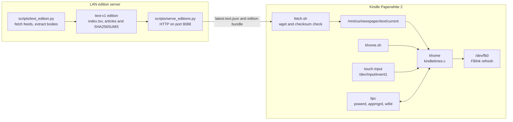

[English](README.md) | [日本語](README.ja.md)

# khome — Kindle Paperwhite 2 のホーム画面と新聞リーダー

khome は Kindle の純正 UI を C 製の小さなホーム画面に置き換え、**The Kindle Times** は LAN 内のサーバーで作ったテキスト版を、オフラインでも読める新聞として端末に表示します。


## 機能

### ホームと一面

| **ホーム** | **The Kindle Times — 一面** |
|:---:|:---:|
|  |  |
| 時計、日付、号数の下に **Apps** が並びます。Newspaper、Manga（KOReader）、Browser、Settings です。Browser の下の **Portrait / Landscape** はブラウザ自身の向き設定を書き換えるので、次に Browser を開いたときからその向きになります。<br><br>**Favorites** は khome が持つお気に入り一覧です。タイルをタップすると開き、長押しすると削除できます。6 件を超えると矢印でページを送ります。追加はブラウザの引き出しシートの **Favorite** から行います。 | 日付と号数の入った題字、トップ記事、短報、「きょうの紙面」の索引を載せます。紙面は端末上でテキストから組み、題字、罫線、見出し、リード、ページ番号は khome が描きます。ページ画像をダウンロードするのではありません。 |

**The Kindle Times** は LAN サーバーが作った版を取り込み、チェックサムを検証して `/mnt/us/newspaper/text/current` にキャッシュします。khome は通信より先にキャッシュ済みの版を描くため、最後に取得した版はオフラインでも読めます。

### 紙面、記事、設定

| **The Kindle Times — 紙面** | **The Kindle Times — 記事** | **設定** |
|:---:|:---:|:---:|
|  |  |  |
| 後のページほど重要度の低い記事を並べます。各記事はジャンル、配信元、公開時刻、見出し、リードを表示し、タップすると本文を開きます。 | 配信元と時刻を添えた記事本文です。末尾には「次の記事」への案内があり、**Aa** で本文サイズを 26、30、36 px の順に切り替えられます。 | **Wi-Fi** のオン/オフ（SSID と IP）、**フロントライト** 16 段階、**Newspaper** の更新と最終更新時刻、**Charge limit**（「Stop at 80% for storage」）、**Restart**（端末全体またはホーム画面のみ）、**Stock system**（ランチャーを終了して純正 UI に戻す）があります。 |

### URL 入力

| **URL 入力キーボード** |
|:---:|
|  |
| **Edit URL** は長い URL を 4 行に折り返します。Cancel / Open、Clear all、QWERTY 配列と記号配列、Shift、左右カーソル、`.com` キーがあります。ブラウザの引き出しで現在の URL または **New tab** をタップすると開きます。 |

## 仕組み



`khome.sh` は端末側のラッパーです。X と周辺の純正サービスを生かしつつ Java フレームワーク（`cvm`）を止めたまま `fakekaf` の代替を起動し、`khome` を走らせ、khome の終了時には純正フレームワークを戻します。`khome` は縦 758 × 1024 の 8 ビットキャンバスを描いて `/dev/fb0` に転送し、FBInk に GC16 または GL16 のリフレッシュを依頼します。タッチは evdev から、電源キー、電池、Wi-Fi、ブラウザ起動、スクリーンセーバーのイベントは lipc から受け取ります。

サーバー側では `scripts/text_edition.py` が公開フィードを取得して記事本文を抽出し、チェックサム付きの `text-v1` バンドルを作ります。`scripts/serve_editions.py` がそれを LAN 向けの素の HTTP/1.1 で配信します。Kindle 側の `fetch.sh` は `latest-text.json` を取得し、`SHA256SUMS` と `manifest.json` を検証してから、バンドル全体が正しいときだけ `current` を `previous` に回します。取得に失敗してもキャッシュ済みの版はそのまま残ります。スリープ中は純正のスクリーンセーバーが画面を持ち、`outOfScreenSaver` の後に khome が元の画面を描き直します。

## 対象機種と前提

- Kindle Paperwhite 2（Pinot / Wario ボード）
- 758 × 1024、212 dpi、16 階調
- ファームウェア 5.12.2.1.1
- armv7 soft-float（armel）

脱獄、KUAL、FBInk 入りの USBNetwork、root SSH が必要です。Manga を使うには `/mnt/us/koreader/koreader.sh` に KOReader が入っている必要があります。純正の Library は常に退避先です。復旧できる見込みのない端末では使わないでください。

## ビルド

ARM ビルドには `zig`、ホスト側のビルドと描画テストには C コンパイラと Python 3 を使います。

```sh
cd launcher
./build.sh test    # ホストビルド、C テスト、描画・モック・ゴールデン検査
./build.sh arm     # 静的 ARM の khome とベンチマーク
./build.sh all     # 両方
./build.sh golden  # 意図した描画変更のあと launcher/tests/golden/device/*.png を更新
```

README のスクリーンショットは端末用ゴールデンからコピーし、hero 画像はそれらから合成します。

```sh
.venv/bin/python scripts/dev/make_readme_images.py
```

Pillow が必要で、プロジェクトの `.venv` に入っています。

## デプロイ

```sh
launcher/tools/deploy.sh            # ビルドして /mnt/us/khome へコピー
```

デプロイスクリプトは `KHOME_HOST`（既定は `kindle`）を使います。`khome`、`fakekaf`、`xexpose`、`xband` をビルドして入れ、フォント、アイコン、`khome.sh`、`emergency.sh`、CA バンドルをコピーします。詳しくは [launcher/README.md](launcher/README.md) を見てください。

SSH から手で起動する場合:

```sh
ssh kindle 'nohup /mnt/us/khome/khome.sh >/dev/null 2>&1 &'
```

起動時の自動開始は、`framework_ready` で `/mnt/us/emergency.sh` を実行する脱獄用の bridge ジョブが担当します。`deploy.sh` はそのスクリプトを置きますが、bridge ジョブ自体はインストールしません。

## 緊急脱出

`/mnt/us/khome/disable` を作って（USB か SSH で）再起動します。このファイルがある間 khome は起動を拒否するので、純正の Library に戻ります。端末が固まったように見えるときも、まずこれを試してください。

`/mnt/us/emergency.sh` を消せば起動時の自動開始は止まります。また `kindle/khome/emergency.sh` は、khome が 90 秒間起動し続けられなかったブートが 3 回続くと自動開始をあきらめます。SSH はその間も使えます。

```sh
ssh kindle 'touch /mnt/us/khome/disable; killall khome'
```

## 新聞サーバー

LAN サーバーで版を作り、そのディレクトリを配信します。

```sh
.venv/bin/python scripts/text_edition.py
python3 scripts/serve_editions.py --root out/editions --host 0.0.0.0 --port 8088
```

版の生成には Python 3 と `feedparser`、`trafilatura`、`lxml` が必要です。HTTP サーバー自体は標準ライブラリだけで動きます。`scripts/install_edition_cron.sh` は任意の 07:00 / 18:00 JST の cron を入れ、`scripts/run_edition_cron.sh` がそのジョブの本体です。

**認証はありません**。信頼できるローカルネットワークだけで動かし、インターネットに公開しないでください。端末は `/mnt/us/newspaper/server.url` からサーバー URL を読みます。`scripts/seed_kindle.sh` は `KINDLE_SERVER_URL` からこのファイルを書き、KUAL 拡張とキャッシュ済みの版を USB 経由で置けます。

## 設定: `private/local.env`

実際のホスト名、IP アドレス、SSID、シリアル番号はコミットしません。これらは `private/local.env` に置き、`private/` 全体と同じく gitignore されています。ファイルは自分で作り、存在するときはスクリプトが読み込みます。

```sh
# private/local.env
KHOME_HOST=kindle
KINDLE_IP=<kindle-ip>
KINDLE_GATEWAY=<gateway-ip>
KINDLE_SSID=<ssid>
KINDLE_SERIAL=<serial>
SERVER_HOST=<server-host>
SERVER_IP=<server-ip>
SERVER_USER=<server-user>
KINDLE_SERVER_URL=http://<server-ip>:8088
```

`scripts/seed_kindle.sh` は `KINDLE_SERVER_URL` を、デプロイ系のスクリプトは `KHOME_HOST` を読みます。`private/` には公開リポジトリに含めないもの（実記事のモック画像、使っていないフォント、別配布の KOReader パッチ）も置いています。

## リポジトリ構成

| パス | 内容 |
|---|---|
| `launcher/` | C 製レンダラと端末ランチャー。ソース、テスト、端末用ゴールデン、デプロイツール。 |
| `launcher/src/` | キャンバス、テキスト、紙面レイアウト（`kindletimes.c`）、フレームバッファ、タッチ、lipc、状態機械、`main.c`。 |
| `launcher/tests/` | C ユニットテスト、描画・モック・ゴールデン検査、ゴールデン用のテキスト版フィクスチャ。 |
| `launcher/third_party/` | 出典を添えた stb ヘッダ。 |
| `kindle/khome/` | 端末側のファイル。`khome.sh`、`emergency.sh`、CA バンドル。 |
| `kindle/extensions/newspaper/` | KUAL 拡張と、チェックサム検証つきで版を取得する `fetch.sh`。 |
| `kindle/fakekaf/`、`kindle/xexpose/`、`kindle/xband/` | 純正フレームワークを抑えている間に使う小さな端末側ヘルパー。 |
| `kindle/koreader/` | 任意の KOReader パッチを端末へ送るスクリプト。 |
| `scripts/` | 版の生成、HTTP サーバー、cron、シード、`scripts/dev/make_readme_images.py`。 |
| `design/` | デザインシステム、フォント、アイコン、レンダラの比較対象になるモック。 |
| `docs/` | 製品仕様、目標、ランチャー設計、ADR、端末での調査メモ。 |
| `docs/images/` | 2 つの README が使うスクリーンショット。端末用ゴールデンから生成。 |
| `tests/` | テキスト版と取得スクリプトのサーバー側テスト。 |
| `out/` | 生成した版と作業用の出力（gitignore）。 |
| `private/` | ローカル設定と公開しない素材（gitignore）。 |

主な文書: [docs/spec.md](docs/spec.md)、[docs/goals.md](docs/goals.md)、[docs/launcher-architecture.md](docs/launcher-architecture.md)、[design/system/README.md](design/system/README.md)、[launcher/README.md](launcher/README.md)、[THIRD_PARTY_NOTICES.md](THIRD_PARTY_NOTICES.md)。

## 免責事項

- このプロジェクトには**保証がありません**。
- 脱獄やシステム UI の置き換えによって、端末が文鎮化したり起動ループに陥ったりするおそれがあります。自己責任で使ってください。
- このプロジェクトは Amazon とは関係がなく、Amazon の承認やサポートも受けていません。Kindle と Paperwhite はそれぞれの権利者の商標です。
- ニュース記事の本文は**個人で使う目的に限り**取得します。抽出した記事本文や版を再配布しないでください。著作権は元の配信元に帰属します。

## ライセンス

特に断りのない限り MIT ライセンスです。[LICENSE](LICENSE) を見てください。同梱する第三者素材は [THIRD_PARTY_NOTICES.md](THIRD_PARTY_NOTICES.md) にまとめています。
