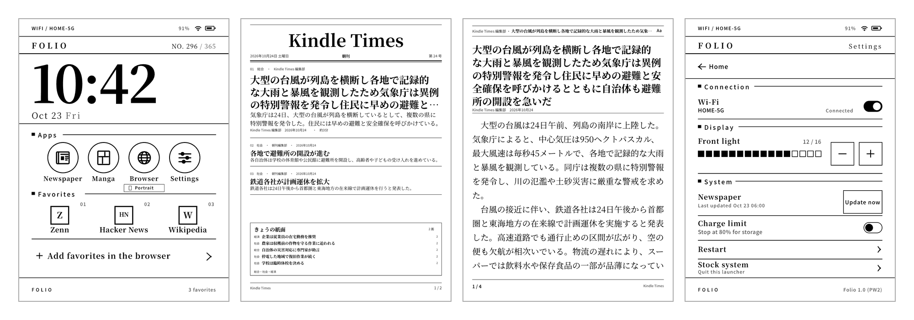
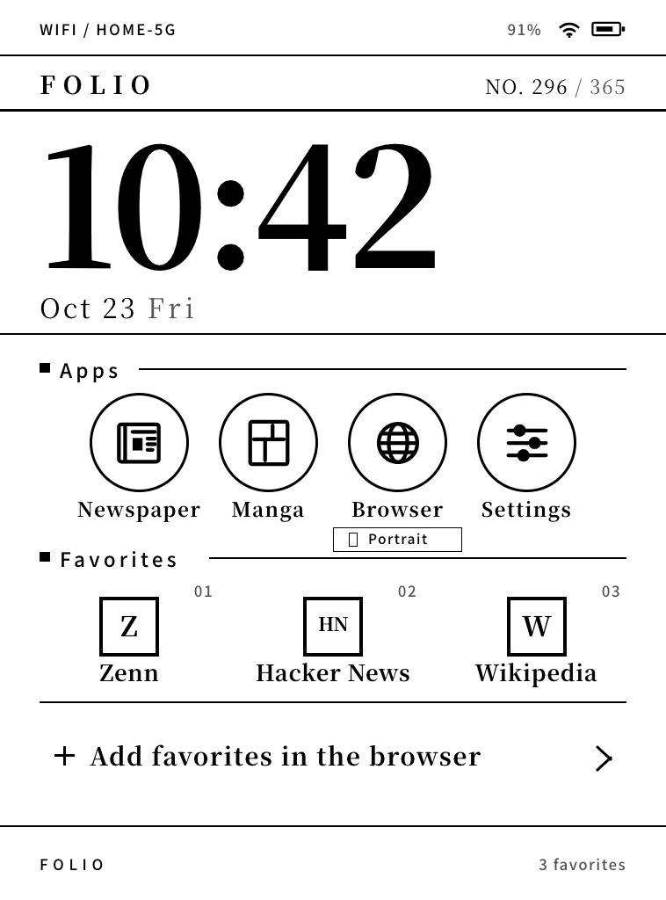
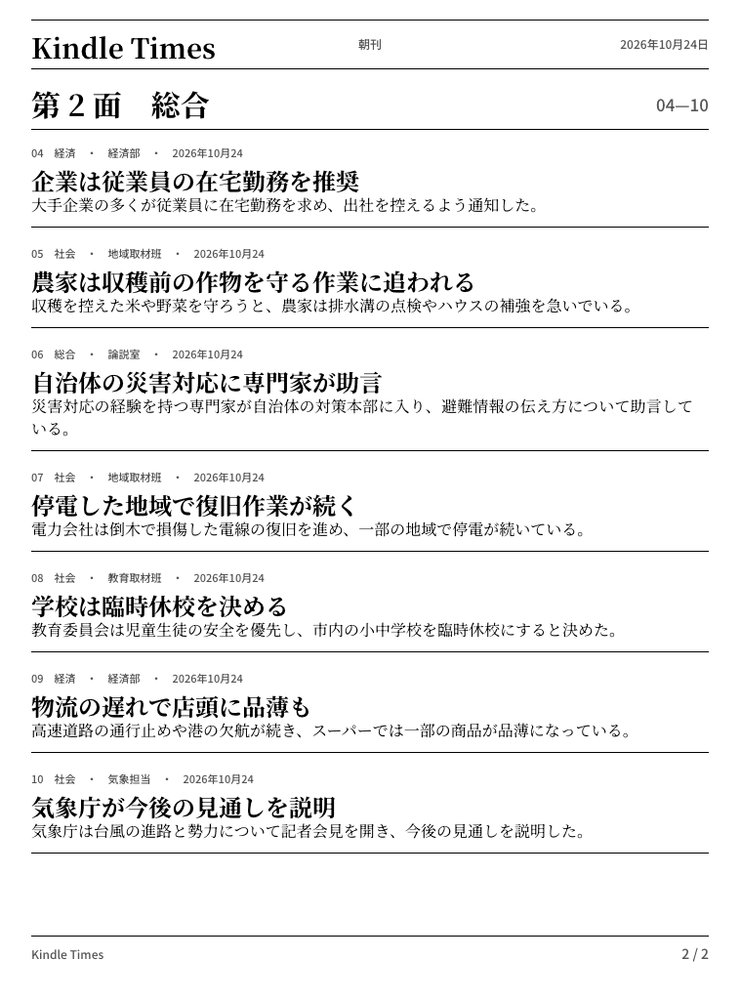
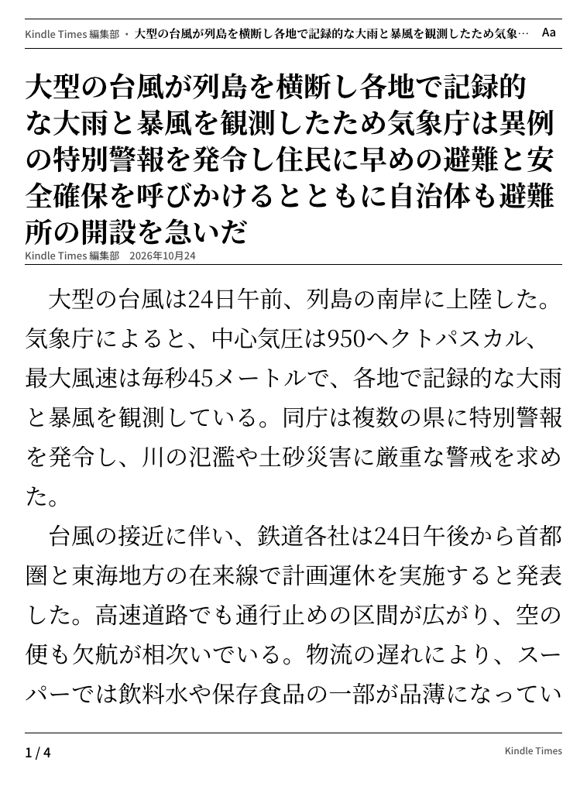
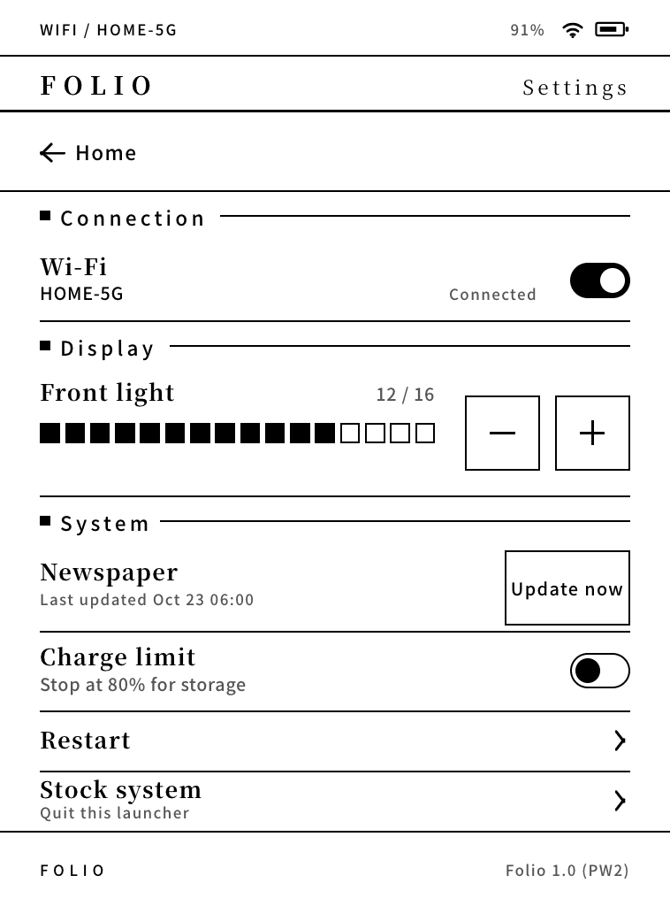
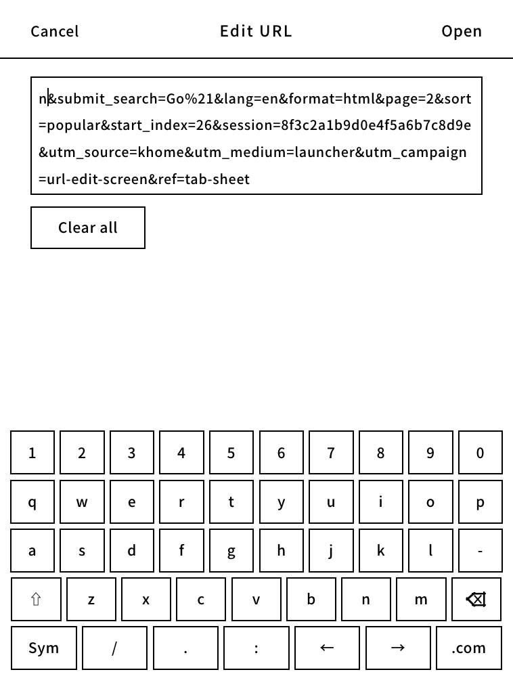
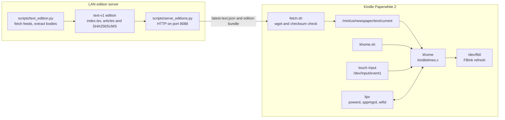

[English](README.md) | [日本語](README.ja.md)

# khome — a Kindle Paperwhite 2 home screen and newspaper reader

khome replaces the stock Kindle UI with a small C home screen, and **The Kindle Times** turns a text edition built on a LAN server into a newspaper that stays readable offline.



## Features

### Home and the front page

| **Home** | **The Kindle Times — front page** |
|:---:|:---:|
|  |  |
| The clock, date and issue number sit above the **Apps** row: Newspaper, Manga (KOReader), Browser and Settings. Under Browser, the **Portrait / Landscape** control writes the stock browser's own orientation setting, so the next Browser launch opens that way.<br><br>**Favorites** are khome's own list. Tap a tile to open it, long-press to remove it, and page through more than six entries with the arrows. Add a site with **Favorite** in the browser's pull-down sheet. | A masthead with the edition date and issue, a lead story, briefs, and a “today's pages” index. The paper is laid out on the device from text: masthead, rules, headlines, leads and page numbers are drawn by khome, not downloaded as page images. |

**The Kindle Times** takes the edition built by the LAN server, verifies its checksums and caches it under `/mnt/us/newspaper/text/current`. khome paints the cached edition before any network access, so the last downloaded edition is still readable offline.

### Inside pages, articles and settings

| **The Kindle Times — inside page** | **The Kindle Times — article** | **Settings** |
|:---:|:---:|:---:|
|  |  |  |
| Later pages carry less important stories. Each item shows its section, source, publication time, headline and lead; tap a story to open it. | The full article body with its source and time, a “next article” prompt at the end, and an **Aa** control that cycles the body size through 26, 30 and 36 px. | **Wi-Fi** on/off with SSID and IP, **front light** in 16 steps, **Newspaper** update with the last-updated time, **Charge limit** (“Stop at 80% for storage”), **Restart** (whole device or the home screen only), and **Stock system** to quit the launcher and return to the stock Kindle UI. |

### URL entry

| **URL entry keyboard** |
|:---:|
|  |
| **Edit URL** wraps a long address over four lines. It has Cancel / Open, Clear all, a QWERTY layout and a symbol layout, plus Shift, cursor keys and a `.com` key. Open it from the browser pull-down by tapping the current URL or **New tab**. |

## How it works



`khome.sh` is the device wrapper: it keeps X and the supporting stock services alive while the Java framework (`cvm`) stays down, starts the `fakekaf` stand-in, runs `khome`, and restores the stock framework when khome exits. `khome` draws a portrait 758 × 1024 8-bit canvas, blits it to `/dev/fb0`, and asks FBInk for a GC16 or GL16 refresh. Touch comes from evdev; the power key, battery, Wi-Fi, browser launch and screen-saver events come through lipc.

On the server, `scripts/text_edition.py` fetches public feeds, extracts full article bodies, and publishes a checksummed `text-v1` bundle. `scripts/serve_editions.py` serves it as plain HTTP/1.1 on the LAN. On the Kindle, `fetch.sh` downloads `latest-text.json`, verifies `SHA256SUMS` and `manifest.json`, then rotates `current` to `previous` only after the whole bundle verifies. A failed fetch leaves the cached edition untouched. While the device is suspended, the stock screen saver owns the panel; after `outOfScreenSaver`, khome repaints the screen it left.

## Target device and prerequisites

- Kindle Paperwhite 2 (Pinot / Wario board)
- 758 × 1024, 212 dpi, 16 gray levels
- Firmware 5.12.2.1.1
- armv7 soft-float (armel)

You need a jailbreak, KUAL, USBNetwork with FBInk, and root SSH access. Manga needs KOReader at `/mnt/us/koreader/koreader.sh`. The stock Library is always the fallback; nothing here should be used on a device you are not prepared to recover.

## Build

The ARM build uses `zig`; the host build needs a C compiler and Python 3 for the render tests.

```sh
cd launcher
./build.sh test    # host build, C tests, render/mock/golden checks
./build.sh arm     # static ARM khome + benchmark
./build.sh all     # both
./build.sh golden  # rewrite launcher/tests/golden/device/*.png after an intended render change
```

The README screenshots are copied from the device goldens, and the hero strip is composed from them:

```sh
.venv/bin/python scripts/dev/make_readme_images.py
```

This needs Pillow, which is installed in the project `.venv`.

## Deploy

```sh
launcher/tools/deploy.sh            # builds and copies to /mnt/us/khome
```

The deploy script uses `KHOME_HOST` (default `kindle`). It builds and installs `khome`, `fakekaf`, `xexpose` and `xband`, then copies the fonts, icons, `khome.sh`, `emergency.sh` and the CA bundle. See [launcher/README.md](launcher/README.md) for details.

To start it by hand over SSH:

```sh
ssh kindle 'nohup /mnt/us/khome/khome.sh >/dev/null 2>&1 &'
```

Boot autostart is handled by the jailbreak bridge job, which runs `/mnt/us/emergency.sh` on `framework_ready`; `deploy.sh` installs that script but not the bridge job itself.

## Emergency exit

Create `/mnt/us/khome/disable` (over USB or SSH) and reboot. khome refuses to start while that file exists, so the stock Library comes back. The same file is the first thing to try if the device appears stuck.

Deleting `/mnt/us/emergency.sh` stops the boot autostart, and `kindle/khome/emergency.sh` also gives up after three boots in which khome did not stay up for 90 seconds. SSH stays available throughout:

```sh
ssh kindle 'touch /mnt/us/khome/disable; killall khome'
```

## Newspaper server

Build an edition on the LAN server, then serve the edition directory:

```sh
.venv/bin/python scripts/text_edition.py
python3 scripts/serve_editions.py --root out/editions --host 0.0.0.0 --port 8088
```

The builder needs Python 3 with `feedparser`, `trafilatura` and `lxml`; the HTTP server itself is standard library only. `scripts/install_edition_cron.sh` installs an optional 07:00 / 18:00 JST cron job, and `scripts/run_edition_cron.sh` is the job it runs.

There is **no authentication**. Run the server only on a trusted local network and do not expose it to the Internet. The device reads its server URL from `/mnt/us/newspaper/server.url`; `scripts/seed_kindle.sh` writes that file from `KINDLE_SERVER_URL` and can seed the KUAL extension and a cached edition over USB.

## Configuration: `private/local.env`

Real host names, IP addresses, SSIDs, and serial numbers are not committed. They live in `private/local.env`, which is gitignored together with the rest of `private/`. Create the file yourself; the scripts source it when it exists.

```sh
# private/local.env
KHOME_HOST=kindle
KINDLE_IP=<kindle-ip>
KINDLE_GATEWAY=<gateway-ip>
KINDLE_SSID=<ssid>
KINDLE_SERIAL=<serial>
SERVER_HOST=<server-host>
SERVER_IP=<server-ip>
SERVER_USER=<server-user>
KINDLE_SERVER_URL=http://<server-ip>:8088
```

`scripts/seed_kindle.sh` reads `KINDLE_SERVER_URL`; the deploy scripts read `KHOME_HOST`. `private/` also holds material that is not part of the public repository (real-article mock screenshots, unused fonts, and a separately distributed KOReader patch).

## Repository layout

| Path | Contents |
|---|---|
| `launcher/` | The C renderer and device launcher: source, tests, device goldens and deploy tools. |
| `launcher/src/` | Canvas, text and newspaper layout (`kindletimes.c`), plus framebuffer, touch, lipc, state machine and `main.c`. |
| `launcher/tests/` | C unit tests, render/mock/golden checks, and the text-edition fixtures used by the goldens. |
| `launcher/third_party/` | stb headers with their provenance. |
| `kindle/khome/` | Device files: `khome.sh`, `emergency.sh` and the CA bundle. |
| `kindle/extensions/newspaper/` | KUAL extension and `fetch.sh`, the checksum-verifying edition downloader. |
| `kindle/fakekaf/`, `kindle/xexpose/`, `kindle/xband/` | Small device-side helpers used while the stock framework is held back. |
| `kindle/koreader/` | Script that sends optional KOReader patches to the device. |
| `scripts/` | Edition builder, HTTP server, cron/seed scripts, and `scripts/dev/make_readme_images.py`. |
| `design/` | Design system, fonts, icons and the mocks the renderer is measured against. |
| `docs/` | Product spec, goals, launcher architecture, ADRs and device spikes. |
| `docs/images/` | Screenshots used by the two READMEs, generated from the device goldens. |
| `tests/` | Server-side tests for the text edition and fetch script. |
| `out/` | Generated editions and scratch output (gitignored). |
| `private/` | Local configuration and material kept out of the public repository (gitignored). |

Key documents: [docs/spec.md](docs/spec.md), [docs/goals.md](docs/goals.md), [docs/launcher-architecture.md](docs/launcher-architecture.md), [design/system/README.md](design/system/README.md), [launcher/README.md](launcher/README.md) and [THIRD_PARTY_NOTICES.md](THIRD_PARTY_NOTICES.md).

## Disclaimer

- This project comes with **no warranty**.
- Jailbreaking and replacing the system UI can brick the device or leave it in a boot loop. Use at your own risk.
- This project is not affiliated with, endorsed by, or supported by Amazon. Kindle and Paperwhite are trademarks of their respective owners.
- News article bodies are fetched for **personal use only**. Do not redistribute extracted article text or editions; the copyright stays with the original publishers.

## License

Unless noted otherwise, this project is MIT licensed; see [LICENSE](LICENSE). Bundled third-party material is listed in [THIRD_PARTY_NOTICES.md](THIRD_PARTY_NOTICES.md).
